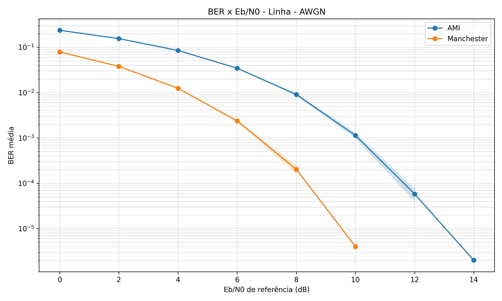
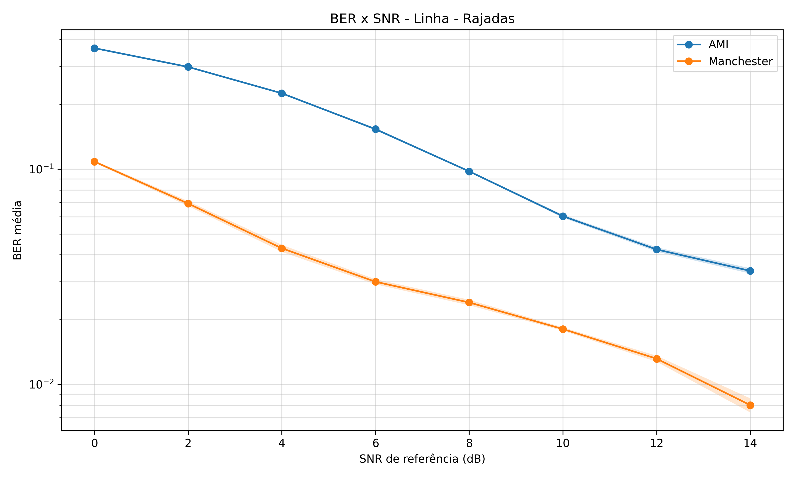
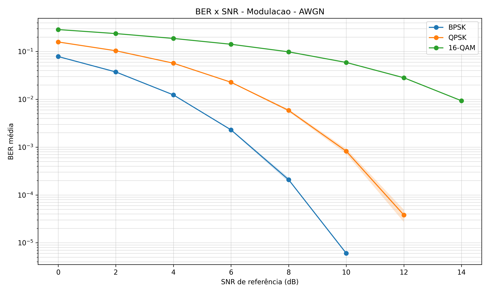
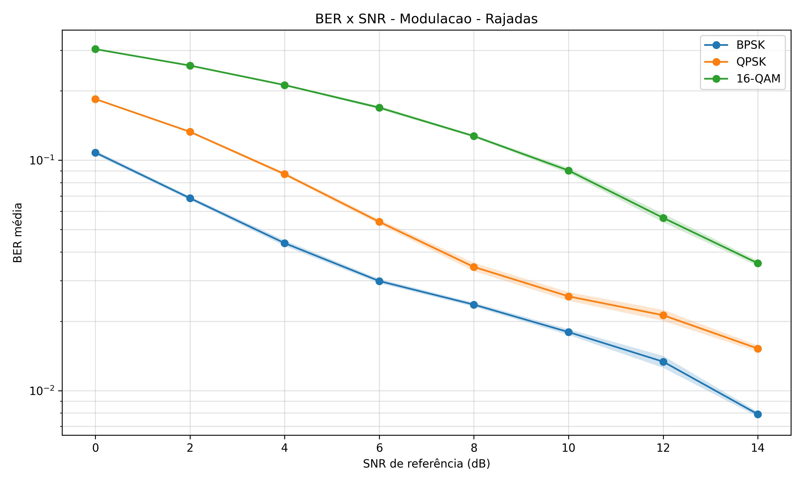

# Simulador de Transmissão Digital

O simulador, em Python, permite estudar codificações de linha, modulações digitais e o efeito de ruído sobre a taxa de erro de bits.

## Requisitos e instalação

- Python 3.10 ou superior.
- Bibliotecas: `numpy` e `matplotlib`.

```bash
python -m pip install numpy matplotlib
```

## Arquitetura

| Arquivo | Função |

| `main.py` | Interface de terminal e orquestração da transmissão |

| `dados.py` | Conversão ASCII e comparação de bits |

| `codificacao.py` | Codificadores e decodificadores AMI e Manchester |

| `modulacao.py` | Moduladores e demoduladores BPSK, QPSK e 16-QAM |

| `canal.py` | AWGN, Rajadas e BER |

| `canal_linha.py` | Normalização e ruído para sinais de linha |

| `visualizacao.py` | Visualização da codificação, constelação e sinais ruidosos |

| `experimentos.py` | Automação, estatísticas, gráficos e exportação CSV |


## Execução

**Entrada de dados via teclado** — execute na pasta do projeto:

```bash
python main.py
```

Digite uma mensagem ASCII, selecione a codificação de linha (AMI ou Manchester), a modulação (BPSK, QPSK ou 16-QAM), o canal (ideal, AWGN ou rajadas) e, quando aplicável, o valor de SNR em dB. O programa vai mostar a mensagem recuperada, a BER e os gráficos.

**Experimentos automatizados**:

```bash
python experimentos.py
```

O script vai executar 400 ensaios: 5 métodos (2 codificações de linha e 3 modulações) × 2 canais × 8 valores de SNR × 5 repetições. Sendo 100.000 bits por ensaio.

## Arquivos gerados

A execução de `experimentos.py` cria a pasta `resultados/` com:

- `execucoes_detalhadas.csv`: **400 linhas** (uma por ensaio).
- `estatisticas.csv`: **80 linhas** (média e desvio-padrão por método/canal/SNR).
- `eficiencia_espectral.csv`: **3 linhas** (modulação, bits por símbolo e eficiência nominal).
- `ber_vs_eficiencia.csv`: **48 linhas** (3 modulações × 2 canais × 8 valores de SNR; BER média, desvio-padrão e eficiência nominal).
- `ber_linha_awgn.png`, `ber_linha_rajadas.png`, `ber_modulacao_awgn.png`, `ber_modulacao_rajadas.png`.

## Gráficos
Os gráficos apresentam a relação entre a taxa de erro de bits (BER) e a relação sinal-ruído (SNR), comparando o desempenho das codificações de linha e das modulações digitais nos canais AWGN e com ruído em rajadas.


O aumento da SNR reduz a BER nas duas codificações. Manchester apresentou menor taxa de erro que AMI em todos os valores analisados, demonstrando maior robustez.


O ruído em rajadas aumenta a BER em ambas as codificações. Manchester mantém melhor desempenho que AMI, mas as interferências concentradas provocam erros mesmo em valores mais elevados de SNR.


BPSK apresentou a menor BER. Modulações com mais bits por símbolo possuem maior eficiência espectral, porém apresentam maior sensibilidade ao ruído para a mesma SNR.


O canal com rajadas apresentou taxas de erro superiores às do AWGN. BPSK manteve a maior robustez, enquanto o 16-QAM apresentou a maior BER, evidenciando o impacto das interferências intensas sobre modulações de ordem superior.

## Vídeo

Link do Video: https://youtu.be/8PZ84JxSUT4
